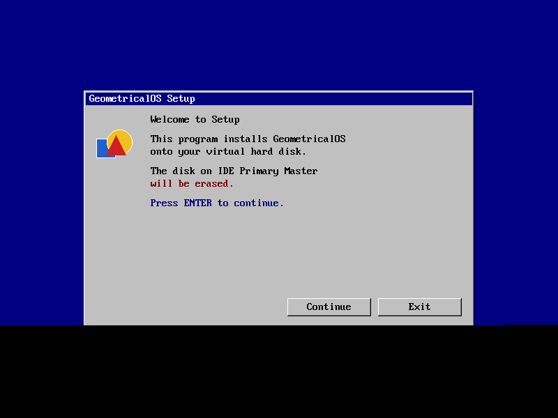
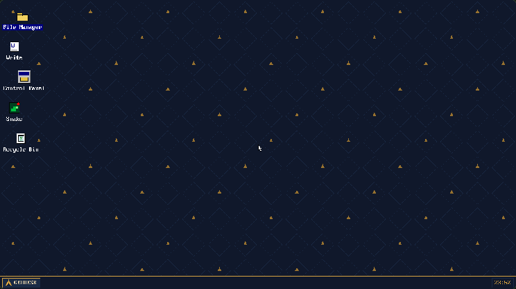
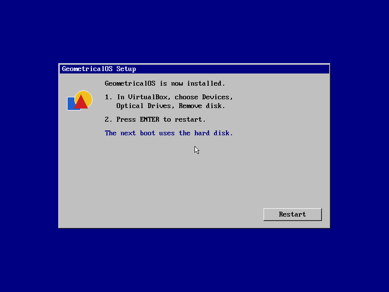
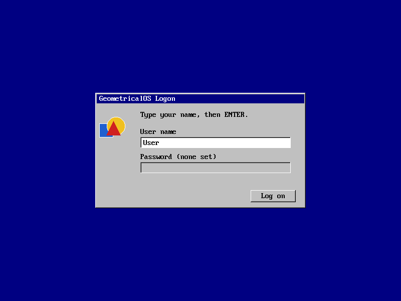
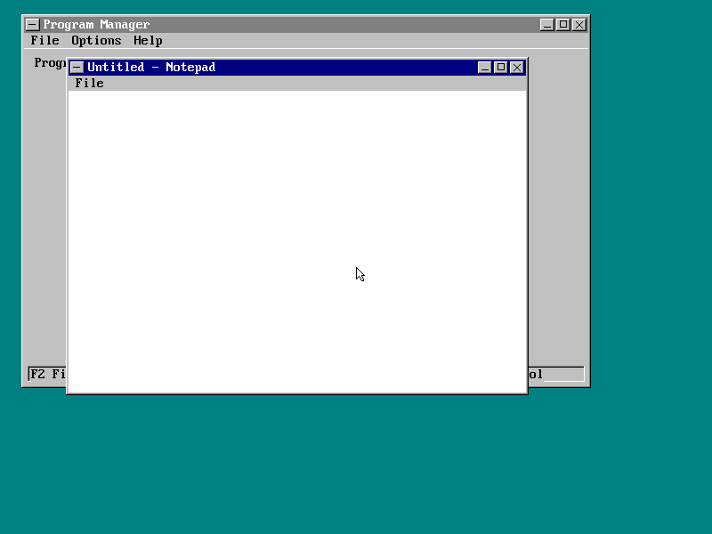
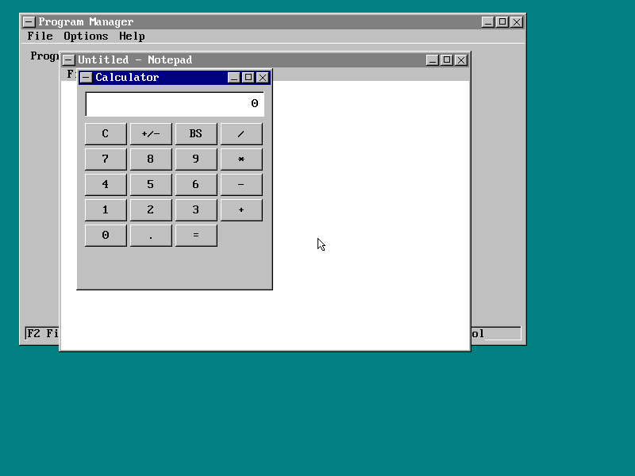
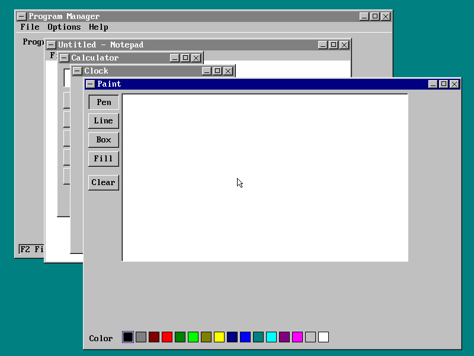
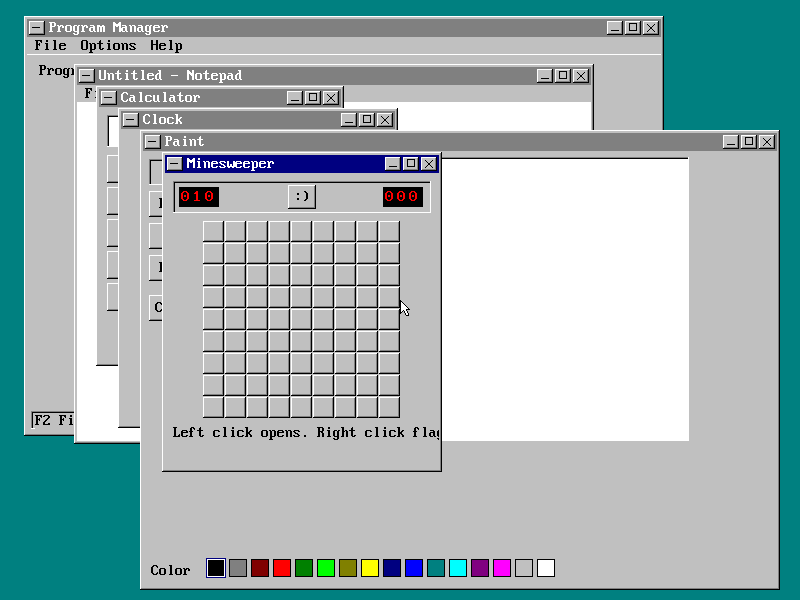
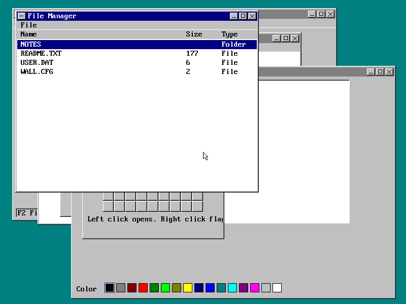
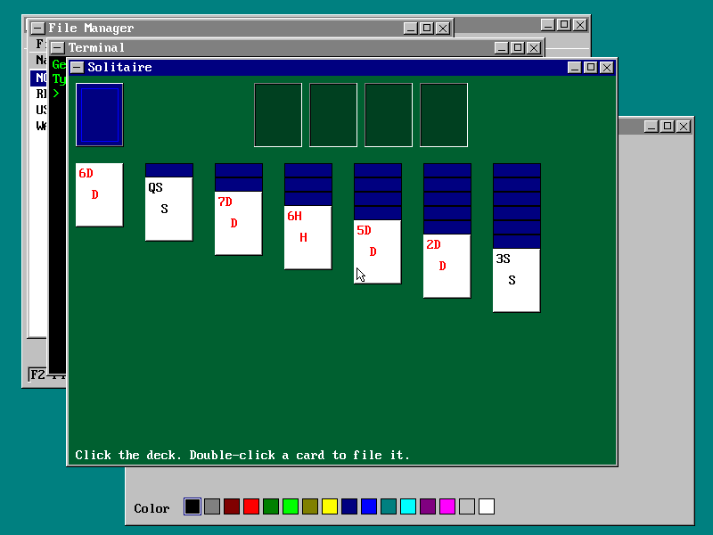

# GeometricalOS

A tiny hobby operating system inspired by Windows 3.1, with a real installer, a mouse-driven desktop, and classic apps like Notepad, Paint, and Minesweeper. Runs in VirtualBox.

It is not Linux. It is a 32-bit freestanding kernel with its own bootloader, a small filesystem, and a geometric workstation desktop. Navy-and-amber colors, a bottom GeoDeck taskbar, and an original patterned wallpaper give it its own identity, while pixel icons, beveled controls, and menu-driven apps keep a 1990s feel.



## What you can do
- Boot the CD and run **GeometricalOS Setup**, which partitions the virtual hard disk, formats it, copies the system, and installs a bootloader.
- Eject the CD and boot GeometricalOS from the hard disk.
- Log on with the name you chose during Setup. A password is optional.
- Use the mouse and keyboard on a retro geometric desktop with a bottom taskbar.
- Open **GeoDeck** for the Workspace, Utilities, and Arcade app groups, or click desktop shortcuts.
- Open **File Manager, GeoFind, Recent Documents, Run, Help, Disk Space & Backup**, and the classic apps.
- View PNG, JPG, JPEG, and WebP pictures in the Image Viewer; images up to 2.1 megapixels are supported.
- Each app has its own small pixel-art icon, so similar utilities are easier to tell apart.
- Cut, copy, paste, rename, and drag files between File Manager folders, the Desktop, and Recycle Bin.
- Right-click files for common actions; recover deleted files and open the startup recovery tools.
- Pick a geometric wallpaper, wait for the flying-shapes screensaver, and shut down or restart.



## Pictures

| | |
| --- | --- |
|  |  |
|  |  |
|  |  |
|  |  |
|  |  |

The boot splash is a static geometric logo (a square, a circle, and a triangle) with the name GeometricalOS. It stays up for a couple of seconds, then the logon screen appears.

## Boot it from a 64 GB USB stick with Rufus

This is a second boot choice next to Windows. GeometricalOS does not install onto the internal SSD, and Setup will not erase that disk. The stick is only the boot drive. On a computer with no IDE disk, choose **Start** to open a temporary desktop that lives in memory until you restart.

The Omen (Ryzen 7 8745HX) boots with UEFI. Secure Boot has to be off, because this loader is not signed by Microsoft.

1. Download `dist/GeometricalOS.iso`.
2. Open Rufus 4. The empty window may say **MBR** and **BIOS or UEFI-CSM**. That changes after you select the ISO.
3. **SELECT** `GeometricalOS.iso`.
4. If Rufus asks about the write mode, choose **ISO Image mode** (the one that formats the stick). DD Image mode also boots, but it does not turn the rest of the 64 GB into a usable drive.
5. Use these settings. They match a 64 GB stick:
   - Partition scheme: **GPT**
   - Target system: **UEFI (non CSM)**
   - File system: **Large FAT32** (this is the option Rufus offers above 32 GB)
   - Cluster size: **32 kilobytes**
6. **START** and accept the prompts. Rufus formats the whole stick and copies `\EFI\BOOT\BOOTX64.EFI`. The file is a few hundred kilobytes, so the 32 KB clusters and the 4 GB FAT32 file limit are not a problem.
7. Shut Windows all the way down. Insert the stick, power on, and tap **Esc**, then **F9**, and choose the USB device. Leave Windows Boot Manager as the default. With the stick unplugged, the computer boots Windows as before.
8. At Setup, enter a name. When it says no IDE disk was found, press **Enter** for **Start**. Do not look for an Install button on this computer. There is nothing here for Setup to partition.
9. To go back to Windows, choose **Exit** or shut down, remove the stick if you want, and power on normally.

A CD burned from the same ISO boots on UEFI and on BIOS. VirtualBox is unchanged: keep the IDE disk and the CD on the secondary master, and use Install there.

## Try it in VirtualBox on Windows 11

You do not have to build anything. Use `dist/GeometricalOS.iso`.

1. Install [VirtualBox](https://www.virtualbox.org/) for Windows.
2. Click **New**.
3. Name: `GeometricalOS`
4. Type: **Other**
5. Version: **Other/Unknown** or **Other/Unknown (32-bit)**
6. Memory: **64 MB** (32 MB is the minimum that is comfortable; do not go below 16 MB)
7. Hard disk: **Create a virtual hard disk now**, VDI, dynamically allocated, **32 MB** or **64 MB**.
8. Finish the wizard, then select the VM and open **Settings**. Change these before the first boot:

### System

- Motherboard, chipset: **PIIX3** (the default is fine)
- Pointing device: **PS/2 Mouse**
- Leave **Enable I/O APIC** either on or off. GeometricalOS polls the keyboard and mouse, so it does not depend on the I/O APIC.

### Display

- Graphics controller: **VBoxVGA** or **VBoxSVGA**
- Video memory: 16 MB is plenty
- Turn **3D Acceleration** off
- For live window/fullscreen resizing, enable **View > Auto-resize Guest Display** after the OS starts. GeometricalOS selects a higher-resolution VESA mode when available and handles VirtualBox resize requests up to its framebuffer limit.

### Audio

- Enable audio
- Audio controller: **Sound Blaster 16**
- Startup and shutdown chimes and Media Player tunes use the Sound Blaster. Use Control Panel > Sound > **Test** to check it, and make sure Sounds are on and the volume is above zero. The PC speaker also beeps; VirtualBox may not play PC speaker beeps.

### Storage — this part matters

VirtualBox usually adds a **SATA** controller. GeometricalOS does not speak SATA or AHCI. It only speaks old IDE.

1. Under Storage, remove the SATA controller if one is present (right-click it, **Remove Controller**).
2. Add an **IDE** controller (the chipset PIIX3 or PIIX4 are both fine).
3. On the IDE controller:
   - **Primary Master** (IDE 0, Master): the virtual hard disk
   - **Secondary Master** (IDE 1, Master): the optical drive
4. Click the optical drive and choose the disk file `dist/GeometricalOS.iso`.

### Boot order

In System, Motherboard, boot order:

1. Optical
2. Hard Disk

## Install, then boot from the hard disk

1. Start the VM. A terminal-style boot report shows the actual boot source, BIOS memory, and video mode; then Setup opens on a blue screen.
2. Press **Enter** to continue.
3. Type a name, or just press **Enter** to keep `User`.
4. Type a password, or press **Enter** to leave it blank. The password is stored in a plain text file named `USER.DAT` on the GeometricalOS disk. It is not encrypted.
5. Setup reads the BIOS/VM clock. If it detects a VM, that clock is selected automatically; choose **Change** to edit the date, time, or UTC offset. The BIOS does not provide the host time zone, so the offset defaults to UTC.
6. Read the disk name and size. Press **Enter** to install. This erases the selected hard disk.
7. When Setup finishes, you may remove the installation disk, then press **Enter** to restart.
8. If the installer disk is still inserted, the startup prompt lets you choose: press a key to boot from the CD/DVD, or wait to start GeometricalOS from the hard drive.
9. The boot report confirms the hard-disk boot and shows the detected IDE disk and filesystem. The logo appears, then the logon screen. The name you chose is filled in. Press **Enter**.
10. The geometric desktop appears. Open GeoDeck from the bottom taskbar to browse apps.

## Using the desktop

- Drag a window by its title bar. Click a window to bring it to the front.
- The left title-bar button opens Restore, Minimize, Maximize, and Close. Minimize, maximize, and close are also on the right.
- Minimized and open windows appear as taskbar tabs. Click a tab to restore it; click the active tab to minimize it.
- Click **GeoDeck** on the taskbar, double-click a workspace icon (**Workspace**, **Utilities**, **Arcade**), then double-click a program.
- GeoDeck's **File** menu also offers **Run**, **GeoFind**, **Recent Documents**, and **Disk Space & Backup**. Help → Help Topics has offline guides for every app.
- **Alt+Tab** cycles windows. **Alt+F4** closes the focused window. Choose **File → Exit GeometricalOS** in GeoDeck to shut down or restart.
- The desktop has a **Recycle Bin** icon and shows files moved into its `Desktop` folder. Double-click files or folders to open them; drag icons to rearrange them, onto folders to move them, or onto the bin to delete them.
- **Ctrl+Esc** focuses the desktop; press Enter to open the Recycle Bin.
- Right-click an empty desktop area for quick wallpaper choices, including the Navy-and-Amber **Orbit Grid**.
- **Tab / Shift+Tab** moves focus between buttons. Enter or Space activates the focused button. Use **Alt+F** (or the first letter of another menu) and the arrow keys to navigate menus without a mouse.
- The boot report stays visible for five seconds. Press **F8** to open Startup Recovery.
- **File → Exit GeometricalOS** asks Shutdown, Restart, or Cancel. Shutdown shows “It is now safe to turn off your computer.” Press Enter there to try powering off the computer. Restart reboots.
- The screensaver starts after about 45 seconds with no keyboard or mouse input. Press a key or move the mouse to come back.
- **Options → Wallpaper** switches between solid, tiles, stripes, diamonds, and Orbit Grid. The choice is saved on disk.

### Transfer files with FileZilla

The **FTP Server** utility shares only the `Transfer` folder with FileZilla. It uses anonymous, unencrypted FTP, so keep the VM adapter on a private **Host-only Adapter** network. Do not use Bridged networking or expose/forward FTP ports to the Internet.

1. Shut down the VM. In VirtualBox **Settings → Network → Adapter 1**, enable the adapter, choose **Host-only Adapter**, and select the host-only network interface.
2. In **Advanced → Adapter Type**, choose **PCnet-FAST III (Am79C973)**. Make sure **Cable Connected** is checked.
3. The server uses guest address `192.168.56.2/24` and passive ports `50000-50003`. Set or confirm the Windows host-only adapter address is `192.168.56.1` with mask `255.255.255.0`. The guest does not use DHCP.
4. Start GeometricalOS and open **GeoDeck → Utilities → FTP Server**. Leave the window running; it reports whether the PCnet card was detected.
5. In FileZilla Client's Site Manager, use:
   - Protocol: **FTP - File Transfer Protocol**
   - Host: `192.168.56.2`; Port: `21`
   - Encryption: **Only use plain FTP (insecure)**
   - Logon type: **Anonymous**
   - Transfer Settings: **Passive**
6. Connect. The server's `/` is the GeometricalOS `Transfer` folder. Use File Manager to put files there before connecting, or drag files in FileZilla to upload them. The File Manager refreshes an open folder every second; drag transferred files onto the Desktop to move them out of `Transfer`. FileZilla cannot receive directory-change notifications over FTP, so press F5 in its remote pane to see files added from GeometricalOS. Downloads are limited to files in `Transfer`. Individual files are limited to 512 KiB by GeoFS; FTP requires a VM with at least 32 MB of RAM.

Plain FTP does not encrypt files or credentials. Use this only on the private Host-only link and stop the server when finished. The minimal PCnet/IP/TCP implementation is intended for this VirtualBox adapter and does not provide DHCP, Internet routing, TLS, or active FTP.

### Keyboard shortcuts

| Key | Program |
| --- | --- |
| F2 | File Manager |
| F3 | Notepad |
| F4 | Calculator |
| F5 | Clock |
| F6 | Paint |
| F7 | Minesweeper |
| F8 | Terminal |
| F9 | Solitaire |
| F10 | Control Panel |
| F11 | Media Player |
| F12 | Snake |
| Ctrl+F2 | Write |
| Ctrl+F3 | Character Map |
| Ctrl+F4 | Cardfile |
| Ctrl+F5 | System Information and Recovery |
| Ctrl+F6 | Recycle Bin |
| Ctrl+X / Ctrl+C / Ctrl+V | Cut / copy / paste in File Manager |
| F2 (inside File Manager) | Rename the selected item |

### The programs

- **Notepad** — File → New, Open, Save, and Save As. The dialog lists folders and files, has a file-name box, and OK / Cancel. Closing a changed document asks whether to save. Files stay on the GeoFS disk across reboots. Open `.TXT` from File Manager.
- **Write** — a simple word processor with bold, italic, underline, and paragraph alignment. Save and reopen its own `.WRI` format; Ctrl+B/I/U toggle styles, Ctrl+S saves, and Ctrl+V inserts the character selected in Character Map.
- **Image Viewer** — opens `.PNG`, `.JPG`, `.JPEG`, and `.WEBP` images from File Manager or its File → Open menu, and fits the picture to the window. It needs at least 32 MB of VM memory; images are limited to 2.1 megapixels and GeoFS's 512 KiB file-size limit.
- **Character Map** — browse the printable ASCII characters with the keyboard or mouse, then Copy and paste the selection into Write with Ctrl+V.
- **Cardfile** — create titled note cards, edit them with the keyboard, and save/open them as `.CRD` files.
- **Calculator** — mouse or keyboard. `+ - * /`, decimal point, backspace, and C.
- **Clock** — analog and digital local time. Set the date, time, and fixed UTC offset in Control Panel → Date/Time; the offset is saved in `SETTINGS.CFG` and the date/time are written to the hardware RTC. The RTC is treated as UTC, and daylight-saving transitions are not automatic. A working battery-backed RTC is required to keep time while powered off.
- **Paint** — Pen, Line, Box, Fill, Clear, and 16 colors. Keys: P, L, B, F, C. File → Save writes a `.GIM` picture. File Manager opens those in Paint. Unsaved changes are asked about on close.
- **Minesweeper** — beginner 9×9 grid, 10 mines. Left click opens, right click flags. The first click is never a mine. Click the face to start over.
- **File Manager** — drag items onto folders to move them, onto the Desktop to put them there, or onto the Recycle Bin to delete them. Rearrange desktop icons by dragging them to an empty spot or onto another icon to swap places. Right-click for Open, Rename, Delete, Cut, Copy, and Paste Here; Edit → Cut/Copy/Paste and F2 are also available. Open `.TXT` in Notepad, `.WRI` in Write, `.CRD` in Cardfile, and `.GIM` pictures in Paint.
- **GeoFind** — search files by name, extension/type, or containing folder, then open supported documents from the result list.
- **Recent Documents** — reopen the ten most recently opened text, Write, Paint, and Cardfile documents. Recycled, missing, or renamed entries are ignored.
- **Run** — launch an app by name or open a supported document by its exact file name.
- **Help** — offline guides for each app, keyboard shortcuts, and common fixes.
- **Disk Space & Backup** — view the detected disk's total capacity, boot/system image, GeoFS metadata and files, reserved space, and free GeoFS capacity. Create or restore a `Backups\Latest` snapshot; it is stored on the same virtual disk, so keep another copy elsewhere to protect against disk loss. In the browser version, use **Download backup** for a portable raw-disk copy.
- **Recycle Bin** — right-click items to restore, rename, or permanently delete them; drag items into the bin to recycle them. Restoring is refused if the original name is already in use.
- **Terminal** — type `help`. Commands: `dir` or `ls`, `cd`, `type` or `cat`, `echo`, `cls`, `mkdir`, `del` (moves to Recycle Bin), `ver`, `date`, `time`, `shutdown`, and `restart`.
- **Control Panel** — color scheme, desktop pattern, screensaver, mouse speed and buttons, date/time and fixed UTC offset, sound (full volume by default), and settings recovery. Display, mouse, sound, clock, wallpaper, and icon-position settings are stored together in `SETTINGS.CFG`; the previous saved settings are kept in `SETTINGS.BAK`.
- **System Information and Recovery** — show BIOS/video/disk details, restore the last saved settings, or reset settings to defaults. Press F8 during startup for Safe Mode, diagnostics, and settings recovery.
- **Media Player** — Play, Pause, and Stop for five short built-in tunes, with a position bar. Sound Blaster 16 plays them when that card is selected; otherwise the PC speaker does.
- **FTP Server** — transfer files with FileZilla over a VirtualBox Host-only network. Anonymous plain FTP is restricted to the `Transfer` folder; use it only on a private network.
- **Solitaire** — Klondike, one card at a time. Click the deck to draw. Click a card, then a pile, to move it. Double-click a card to file it on a foundation when the rules allow. Press N for a new game.
- **Snake** — steer with the arrow keys or WASD, eat the apples to grow, and avoid the walls and your tail. Press Space to pause or N to start a new game.

## Run GeometricalOS in a browser

The single `geometricalos.html` file embeds the GeometricalOS installer, v86 emulator, WebAssembly runtimes, and BIOS images. Save that file and open it directly in a modern browser; no separate project files, web server, or internet connection are required. The guest has no network adapter.

Start the VM to boot the embedded installer ISO into Setup. Click inside the VM display to capture the mouse; press **Esc** to release it. Use **Fill page** to cover the browser page, then press **Esc** or choose **Exit full-page view** to return. Use your browser's F11 key if you want to hide the browser chrome. Install to the provided 32 MiB IDE disk, eject the installer disc, and reboot. Disk changes autosave in browser storage; use **Download backup** to keep a portable raw `.img` copy.

## Build it yourself (Linux or WSL)

You need `nasm`, `gcc` with 32-bit support (`gcc-multilib`), `xorriso`, `mingw-w64` for the 64-bit UEFI loader, `mtools`, `dosfstools`, `make`, and `python3`.

```bash
sudo apt update
sudo apt install -y nasm gcc-multilib xorriso gcc-mingw-w64-x86-64 mtools dosfstools make python3
make
```

`make` writes `dist/GeometricalOS.iso`. `make run` boots that ISO in QEMU. `make clean` deletes the build files.

The kernel is freestanding C and NASM. It enters 32-bit protected mode, sets a VESA graphics mode (it prefers 1280×720 when available), and does not use the Linux kernel or GRUB.

## How the disk is laid out

- Sector 0 is the master boot record. It loads the system with BIOS LBA reads.
- The system image starts at sector 64.
- The filesystem starts at sector 2048. It is **GeoFS**, a small custom filesystem (not FAT). Windows cannot browse it by opening the VDI. Use File Manager and Terminal inside GeometricalOS.
- Setup writes `README.TXT`, a `NOTES` folder, `USER.DAT`, and `WALL.CFG`.

## Troubleshooting

| What you see | What to do |
| --- | --- |
| “No hard disk” or Setup never sees a disk | The hard disk must be the **IDE Primary Master**. A SATA or NVMe disk will not work. |
| Setup says the primary master is the CD | Put the ISO on the **Secondary Master**, not the primary master. |
| The screen stays on a line that starts with `GeometricalOS:` | That line is the last step that finished. `loading from CD` means the disc read failed (check that the ISO is the IDE Secondary Master). `setting VESA mode` with a black screen after it means the graphics card has no linear framebuffer; use VBoxVGA or VBoxSVGA with 3D acceleration off. |
| Black screen and no text at all | Use the ISO from this fix. Older builds asked VirtualBox to load the CD at a segment it does not support, so Setup never started. |
| Mouse does not move | Pointing device must be **PS/2 Mouse**. GeometricalOS also asks VirtualBox for an absolute pointer, so the cursor can follow the host without capture when that device answers. |
| No sound | Enable audio and set the controller to **Sound Blaster 16**. In Control Panel > Sound, turn Sounds on, raise the volume, and press **Test**. |
| It boots the installer again | Remove the ISO, then reboot. |
| “This hard disk is not installed” | Boot the ISO and run Setup on that disk. |
| The name or password is rejected | It must match what Setup saved. The default name, if you just pressed Enter, is `User` with no password. |

## Checked in QEMU

The same IDE layout VirtualBox uses was tested with QEMU: hard disk on the primary master, CD on the secondary master, PS/2 mouse, 64 MB RAM, and the standard VGA card. Setup installed onto a blank 32 MB disk, and the next boot came from that disk through logon and into the GeometricalOS desktop.

## Limits

The installer only writes an IDE primary master. It does not see NVMe or SATA, so a Windows SSD is left as it is. A USB stick of any size, including 64 GB, can boot the system through UEFI; xHCI keyboards and mice are polled when the controller is visible. Sound is Sound Blaster 16 or the PC speaker. Items in the Recycle Bin continue to use disk space until the bin is emptied. The temporary desktop started from USB keeps its files in memory only.
