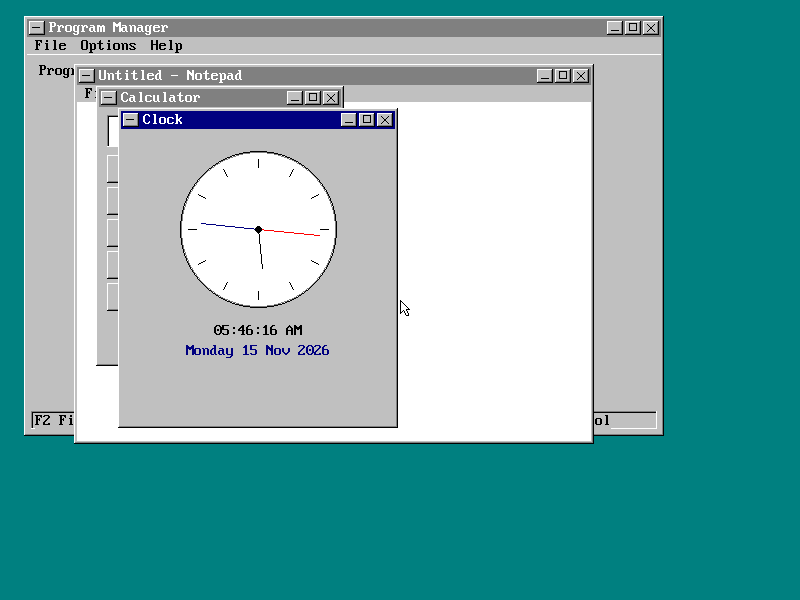
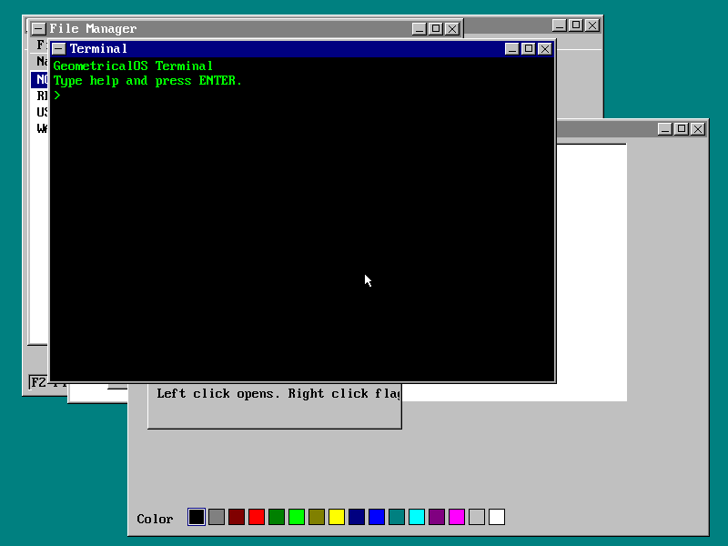

# GeometricalOS

A tiny hobby operating system inspired by Windows 3.1, with a real installer, a mouse-driven desktop, and classic apps like Notepad, Paint, and Minesweeper. Runs in VirtualBox.

It is not Linux. It is a 32-bit freestanding kernel with its own bootloader, a small filesystem, and a desktop that looks like Program Manager: teal background, gray 3D windows, and navy title bars.


## What you can do
- Boot the CD and run **GeometricalOS Setup**, which partitions the virtual hard disk, formats it, copies the system, and installs a bootloader.
- Eject the CD and boot GeometricalOS from the hard disk.
- Log on with the name you chose during Setup. A password is optional.
- Use the mouse and keyboard on a Windows 3.1-style desktop.
- Open **File Manager, Notepad, Calculator, Clock, Paint, Minesweeper, Terminal, Solitaire, and Snake**.
- Pick a geometric wallpaper, wait for the flying-shapes screensaver, and shut down or restart.


## Pictures

| | |
| --- | --- |
|  |  |
|  |  |
|  |  |
|  |  |
|  |  |

The boot splash is a static geometric logo (a square, a circle, and a triangle) with the name GeometricalOS. It stays up for a couple of seconds, then the logon screen appears.

## Try it in VirtualBox on Windows 11

You do not have to build anything. Use `dist/GeometricalOS.iso`.

1. Install [VirtualBox](https://www.virtualbox.org/) for Windows.
2. Click **New**.
3. Name: `GeometricalOS`
4. Type: **Other**
5. Version: **Other/Unknown** or **Other/Unknown (32-bit)**
6. Memory: **64 MB** (32 MB is the minimum that is comfortable; do not go below 16 MB)
7. Hard disk: **Create a virtual hard disk now**, VDI, dynamically allocated, **32 MB** or **64 MB**.
8. Finish the wizard, then select the VM and open **Settings**. Change these before the first boot:

### System

- Motherboard, chipset: **PIIX3** (the default is fine)
- Pointing device: **PS/2 Mouse**
- Leave **Enable I/O APIC** either on or off. GeometricalOS polls the keyboard and mouse, so it does not depend on the I/O APIC.

### Display

- Graphics controller: **VBoxVGA** or **VBoxSVGA**
- Video memory: 16 MB is plenty
- Turn **3D Acceleration** off

### Audio

- Enable audio
- Audio controller: **Sound Blaster 16**
- That plays the startup and shutdown chime through the Sound Blaster. The PC speaker also beeps. If you pick AC'97 or Intel HD Audio instead, you will only get the PC speaker beep, and VirtualBox often does not play that beep.

### Storage — this part matters

VirtualBox usually adds a **SATA** controller. GeometricalOS does not speak SATA or AHCI. It only speaks old IDE.

1. Under Storage, remove the SATA controller if one is present (right-click it, **Remove Controller**).
2. Add an **IDE** controller (the chipset PIIX3 or PIIX4 are both fine).
3. On the IDE controller:
   - **Primary Master** (IDE 0, Master): the virtual hard disk
   - **Secondary Master** (IDE 1, Master): the optical drive
4. Click the optical drive and choose the disk file `dist/GeometricalOS.iso`.

### Boot order

In System, Motherboard, boot order:

1. Optical
2. Hard Disk

## Install, then boot from the hard disk

1. Start the VM. A terminal-style boot report shows the actual boot source, BIOS memory, and video mode; then Setup opens on a blue screen.
2. Press **Enter** to continue.
3. Type a name, or just press **Enter** to keep `User`.
4. Type a password, or press **Enter** to leave it blank. The password is stored in a plain text file named `USER.DAT` on the GeometricalOS disk. It is not encrypted.
5. Setup reads the BIOS/VM clock. If it detects a VM, that clock is selected automatically; choose **Change** to edit the date, time, or UTC offset. The BIOS does not provide the host time zone, so the offset defaults to UTC.
6. Read the disk name and size. Press **Enter** to install. This erases the selected hard disk.
7. When Setup finishes, you may remove the installation disk, then press **Enter** to restart.
8. If the installer disk is still inserted, the startup prompt lets you choose: press a key to boot from the CD/DVD, or wait to start GeometricalOS from the hard drive.
9. The boot report confirms the hard-disk boot and shows the detected IDE disk and filesystem. The logo appears, then the logon screen. The name you chose is filled in. Press **Enter**.
10. Program Manager opens on the teal desktop.

## Using the desktop

- Drag a window by its title bar. Click a window to bring it to the front.
- The left title-bar button opens Restore, Minimize, Maximize, and Close. Minimize, maximize, and close are also on the right.
- Minimized windows sit along the bottom of the desktop. Click one to restore it.
- Double-click a group icon in Program Manager (**Main**, **Accessories**, **Games**), then double-click a program.
- **Alt+Tab** cycles windows. **Alt+F4** closes the focused window. On Program Manager, close means exit.
- **File → Exit GeometricalOS** asks Shutdown, Restart, or Cancel. Shutdown shows “It is now safe to turn off your computer.” Press Enter there to try powering off the computer. Restart reboots.
- The screensaver starts after about 45 seconds with no keyboard or mouse input. Press a key or move the mouse to come back.
- **Options → Wallpaper** switches between solid teal, tiles, stripes, and diamonds. The choice is saved on disk.

### Keyboard shortcuts

| Key | Program |
| --- | --- |
| F2 | File Manager |
| F3 | Notepad |
| F4 | Calculator |
| F5 | Clock |
| F6 | Paint |
| F7 | Minesweeper |
| F8 | Terminal |
| F9 | Solitaire |
| F10 | Control Panel |
| F11 | Media Player |
| F12 | Snake |

### The programs

- **Notepad** — File → New, Open, Save, and Save As. The dialog lists folders and files, has a file-name box, and OK / Cancel. Closing a changed document asks whether to save. Files stay on the GeoFS disk across reboots. Open `.TXT` from File Manager.
- **Calculator** — mouse or keyboard. `+ - * /`, decimal point, backspace, and C.
- **Clock** — analog and digital local time. Set the date, time, and fixed UTC offset in Control Panel → Date/Time; the offset is saved in `SETTINGS.CFG` and the date/time are written to the hardware RTC. The RTC is treated as UTC, and daylight-saving transitions are not automatic. A working battery-backed RTC is required to keep time while powered off.
- **Paint** — Pen, Line, Box, Fill, Clear, and 16 colors. Keys: P, L, B, F, C. File → Save writes a `.GIM` picture. File Manager opens those in Paint. Unsaved changes are asked about on close.
- **Minesweeper** — beginner 9×9 grid, 10 mines. Left click opens, right click flags. The first click is never a mine. Click the face to start over.
- **File Manager** — folders and files. Enter a folder, go up, delete, and open `.TXT` files in Notepad or `.GIM` pictures in Paint.
- **Terminal** — type `help`. Commands: `dir` or `ls`, `cd`, `type` or `cat`, `echo`, `cls`, `mkdir`, `del`, `ver`, `date`, `time`, `shutdown`, and `restart`.
- **Control Panel** — color scheme, desktop pattern, screensaver, mouse speed and buttons, date/time and fixed UTC offset, and sound. Settings are stored in `SETTINGS.CFG`.
- **Media Player** — Play, Pause, and Stop for five short built-in tunes, with a position bar. Sound Blaster 16 plays them when that card is selected; otherwise the PC speaker does.
- **Solitaire** — Klondike, one card at a time. Click the deck to draw. Click a card, then a pile, to move it. Double-click a card to file it on a foundation when the rules allow. Press N for a new game.
- **Snake** — steer with the arrow keys or WASD, eat the apples to grow, and avoid the walls and your tail. Press Space to pause or N to start a new game.

## Build it yourself (Linux or WSL)

You need `nasm`, `gcc` with 32-bit support (`gcc-multilib`), `genisoimage`, `make`, and `python3`.

```bash
sudo apt update
sudo apt install -y nasm gcc-multilib genisoimage make python3
make
```

`make` writes `dist/GeometricalOS.iso`. `make run` boots that ISO in QEMU. `make clean` deletes the build files.

The kernel is freestanding C and NASM. It enters 32-bit protected mode, sets a VESA graphics mode (it prefers 800×600 with 32-bit color), and does not use the Linux kernel or GRUB.

## How the disk is laid out

- Sector 0 is the master boot record. It loads the system with BIOS LBA reads.
- The system image starts at sector 64.
- The filesystem starts at sector 2048. It is **GeoFS**, a small custom filesystem (not FAT). Windows cannot browse it by opening the VDI. Use File Manager and Terminal inside GeometricalOS.
- Setup writes `README.TXT`, a `NOTES` folder, `USER.DAT`, and `WALL.CFG`.

## Troubleshooting

| What you see | What to do |
| --- | --- |
| “No hard disk” or Setup never sees a disk | The hard disk must be the **IDE Primary Master**. A SATA or NVMe disk will not work. |
| Setup says the primary master is the CD | Put the ISO on the **Secondary Master**, not the primary master. |
| The screen stays on a line that starts with `GeometricalOS:` | That line is the last step that finished. `loading from CD` means the disc read failed (check that the ISO is the IDE Secondary Master). `setting VESA mode` with a black screen after it means the graphics card has no linear framebuffer; use VBoxVGA or VBoxSVGA with 3D acceleration off. |
| Black screen and no text at all | Use the ISO from this fix. Older builds asked VirtualBox to load the CD at a segment it does not support, so Setup never started. |
| Mouse does not move | Pointing device must be **PS/2 Mouse**. GeometricalOS also asks VirtualBox for an absolute pointer, so the cursor can follow the host without capture when that device answers. |
| No startup chime | Set the audio controller to **Sound Blaster 16**. |
| It boots the installer again | Remove the ISO, then reboot. |
| “This hard disk is not installed” | Boot the ISO and run Setup on that disk. |
| The name or password is rejected | It must match what Setup saved. The default name, if you just pressed Enter, is `User` with no password. |

## Checked in QEMU

The same IDE layout VirtualBox uses was tested with QEMU: hard disk on the primary master, CD on the secondary master, PS/2 mouse, 64 MB RAM, and the standard VGA card. Setup installed onto a blank 32 MB disk, and the next boot came from that disk through logon, Program Manager, and every built-in program.

## Limits

No networking or Internet access is implemented. One IDE disk, no USB, no sound card besides Sound Blaster 16 and the PC speaker, and deleted files do not always reuse their disk space until you install again.
